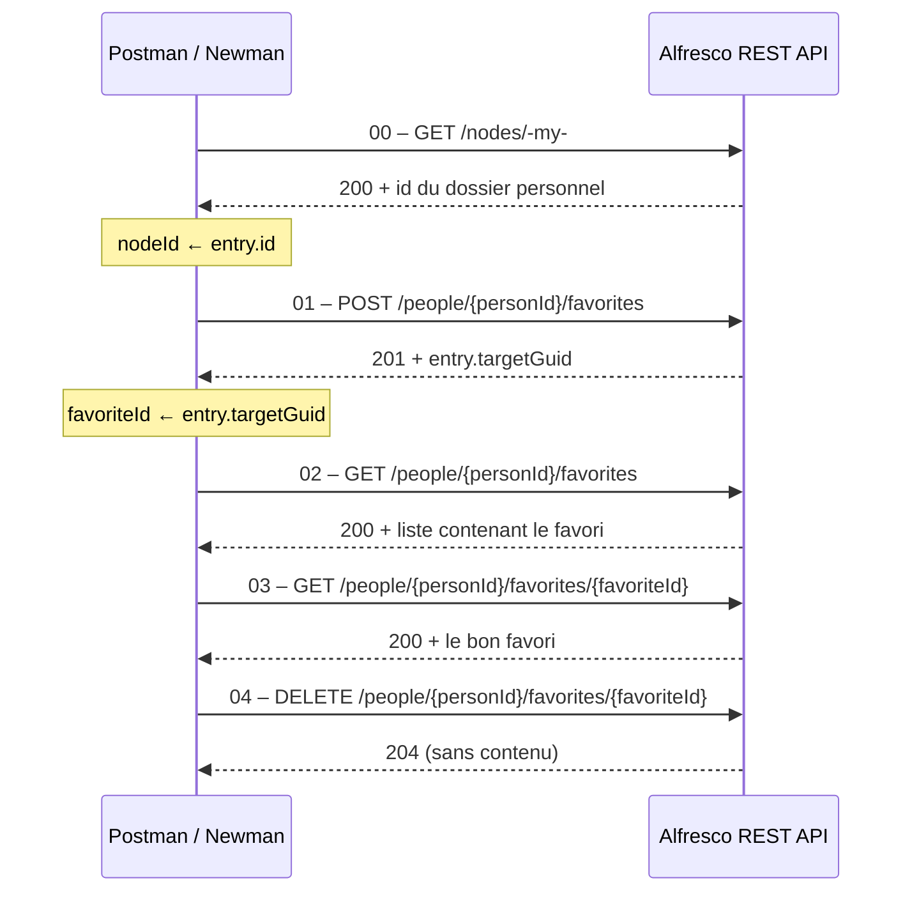

# Alfresco – Tests d'API REST sur les favoris (Postman)

Collection Postman qui valide, de bout en bout, la gestion des **favoris** d'un utilisateur via l'**API REST Core v1 d'Alfresco** : création, liste, lecture et suppression d'un favori.

Chaque requête embarque ses propres tests automatisés (code de statut, structure JSON, temps de réponse, cohérence des données) et les requêtes s'enchaînent grâce à des variables d'environnement alimentées dynamiquement.

---

## Table des matières

1. [Objectifs](#objectifs)
2. [Prérequis](#prérequis)
3. [Structure du dépôt](#structure-du-dépôt)
4. [Installation et configuration](#installation-et-configuration)
5. [Exécution](#exécution)
6. [Scénario de test](#scénario-de-test)
7. [Détail des requêtes](#détail-des-requêtes)
8. [Variables](#variables)
9. [Sécurité](#sécurité)
10. [Dépannage](#dépannage)
11. [Pistes d'amélioration](#pistes-damélioration)
12. [Licence](#licence)

---

## Objectifs

- Vérifier le cycle de vie complet d'un favori Alfresco (**CRUD** sans la mise à jour, qui n'existe pas pour les favoris).
- Contrôler pour chaque appel : le **code HTTP**, la **structure de la réponse** et la **cohérence des données** (le favori créé est bien celui qui est listé, puis lu, puis supprimé).
- Fournir un jeu de tests **rejouable** et **autonome** : la collection récupère elle-même l'identifiant du dossier à mettre en favori et nettoie après son passage.
- Permettre une exécution manuelle (Postman) ou automatisable (Newman en ligne de commande).

## Prérequis

| Outil | Rôle |
|---|---|
| Une instance **Alfresco** accessible (locale ou distante) | Cible des tests |
| Un compte Alfresco autorisé à utiliser l'API REST | Authentification Basic |
| [Postman](https://www.postman.com/downloads/) | Exécution interactive |
| [Newman](https://github.com/postmanlabs/newman) *(optionnel)* | Exécution en ligne de commande / CI |

> L'URL par défaut suppose une instance locale sur `http://localhost:8080`. Adaptez-la dans l'environnement Postman si votre serveur utilise un autre hôte ou port.

## Structure du dépôt

```
Projet_Alfresco_Postman/
├── postman/
│   ├── ALFRESCO-Favorites.postman_collection.json   # Collection : 5 requêtes + tests
│   └── ALFRESCO-Local.postman_environment.json      # Environnement modèle (sans secret)
├── .gitattributes                                    # Fins de ligne normalisées (LF)
├── .gitignore                                        # Exclut secrets, rapports et fichiers locaux
├── LICENSE
└── README.md
```

## Installation et configuration

### 1. Cloner le dépôt

```bash
git clone https://github.com/<votre-utilisateur>/Projet_Alfresco_Postman.git
cd Projet_Alfresco_Postman
```

### 2. Importer dans Postman

1. Ouvrir Postman → **Import**.
2. Glisser les deux fichiers du dossier `postman/` :
   - `ALFRESCO-Favorites.postman_collection.json`
   - `ALFRESCO-Local.postman_environment.json`

### 3. Renseigner l'environnement

Sélectionner l'environnement **ALFRESCO - Local** (menu déroulant en haut à droite), puis compléter ses variables :

| Variable | À renseigner |
|---|---|
| `baseUrl` | URL de l'API, par défaut `http://localhost:8080/alfresco/api/-default-/public/alfresco/versions/1` |
| `username` | Nom d'utilisateur Alfresco |
| `password` | Mot de passe (variable de type *secret*) |

Les variables `nodeId` et `favoriteId` sont **laissées vides** : elles sont remplies automatiquement par les scripts de test.

> ⚠️ Ne commitez jamais un environnement contenant vos identifiants. Le fichier fourni est volontairement vide ; utilisez la valeur « Current value » de Postman (non synchronisée) ou un fichier `*.local.json` ignoré par Git.

## Exécution

### Avec Postman (interface graphique)

**Exécution complète (recommandée)** : clic droit sur la collection → **Run collection** → vérifier que l'ordre est 00 → 04 → **Run**.

Les requêtes dépendent les unes des autres : ne pas les réordonner ni les exécuter isolément (sauf la 00, qui est le point de départ).

### Avec Newman (ligne de commande)

```bash
npm install -g newman

newman run postman/ALFRESCO-Favorites.postman_collection.json \
  -e postman/ALFRESCO-Local.postman_environment.json \
  --env-var "username=<utilisateur>" \
  --env-var "password=<mot-de-passe>"
```

Pour générer un rapport HTML, ajouter [`newman-reporter-htmlextra`](https://github.com/DannyDainton/newman-reporter-htmlextra) :

```bash
npm install -g newman-reporter-htmlextra
newman run postman/ALFRESCO-Favorites.postman_collection.json \
  -e postman/ALFRESCO-Local.postman_environment.json \
  --env-var "username=<utilisateur>" --env-var "password=<mot-de-passe>" \
  -r htmlextra --reporter-htmlextra-export newman/rapport.html
```

Le dossier `newman/` est ignoré par Git.

## Scénario de test



## Détail des requêtes

Toutes les URLs sont relatives à `{{baseUrl}}`. L'authentification est de type **Basic** (`{{username}}` / `{{password}}`), définie au niveau de la collection et héritée par chaque requête.

### 00 – Setup : Get my home folder

| | |
|---|---|
| **Méthode / URL** | `GET {{baseUrl}}/nodes/-my-` |
| **But** | Obtenir l'identifiant du dossier personnel de l'utilisateur, qui servira de cible du favori. |
| **Tests** | Statut `200` · la réponse contient `entry.id` |
| **Variable écrite** | `nodeId` ← `entry.id` |

### 01 – Create a favorite

| | |
|---|---|
| **Méthode / URL** | `POST {{baseUrl}}/people/{{personId}}/favorites` |
| **Corps (JSON)** | `{ "target": { "folder": { "guid": "{{nodeId}}" } } }` |
| **Pré-requête** | Interrompt l'exécution avec une erreur explicite si `nodeId` est vide (la requête 00 n'a pas été exécutée). |
| **Tests** | Statut `201 Created` · temps de réponse < 2000 ms · présence de `entry`, `entry.targetGuid`, `entry.createdAt` · `targetGuid` égal au `nodeId` envoyé |
| **Variable écrite** | `favoriteId` ← `entry.targetGuid` |

### 02 – List favorites

| | |
|---|---|
| **Méthode / URL** | `GET {{baseUrl}}/people/{{personId}}/favorites?maxItems=100` |
| **Tests** | Statut `200` · structure de liste (`list.entries` est un tableau, `list.pagination` présent) · le favori créé en 01 figure dans la liste |

### 03 – Get a favorite

| | |
|---|---|
| **Méthode / URL** | `GET {{baseUrl}}/people/{{personId}}/favorites/{{favoriteId}}` |
| **Tests** | Statut `200` · `entry.targetGuid` correspond à `favoriteId` |

### 04 – Delete a favorite

| | |
|---|---|
| **Méthode / URL** | `DELETE {{baseUrl}}/people/{{personId}}/favorites/{{favoriteId}}` |
| **But** | Nettoyer l'état de l'instance pour que la collection soit rejouable. |
| **Tests** | Statut `204 No Content` · corps de réponse vide |

## Variables

| Variable | Portée | Valeur par défaut | Rôle |
|---|---|---|---|
| `baseUrl` | Collection + environnement | `http://localhost:8080/alfresco/api/-default-/public/alfresco/versions/1` | Racine de l'API Core v1 |
| `personId` | Collection | `-me-` | Alias Alfresco désignant l'utilisateur authentifié |
| `username` | Environnement | *(vide)* | Compte Alfresco |
| `password` | Environnement (*secret*) | *(vide)* | Mot de passe du compte |
| `nodeId` | Environnement | *(vide, rempli par la requête 00)* | Identifiant du dossier mis en favori |
| `favoriteId` | Environnement | *(vide, rempli par la requête 01)* | Identifiant du favori créé |

Les valeurs de l'environnement priment sur celles de la collection.

## Sécurité

Ce dépôt a été préparé pour être public :

- **Aucun identifiant** n'est présent dans la collection ni dans l'environnement : `username` et `password` sont vides et doivent être saisis localement.
- Le mot de passe est déclaré en variable de type **secret** dans l'environnement.
- Les identifiants de compte et de workspace Postman (`_exporter_id`, `_collection_link`) ont été retirés de l'export.
- Aucun identifiant de nœud Alfresco en dur : `nodeId` et `favoriteId` sont générés à l'exécution.
- Le `.gitignore` exclut les environnements locaux (`*.local.json`), les fichiers `.env`, les rapports Newman et les fichiers d'IDE.

Bonnes pratiques à conserver :

- N'exportez pas un environnement dont les *Current values* contiennent des secrets avant de le commiter.
- Utilisez un **compte de test dédié** plutôt qu'un compte administrateur, et changez les mots de passe par défaut d'une installation Alfresco.
- Ne ciblez pas un environnement de production avec ces tests : ils créent et suppriment des données.
- Si un secret a déjà été commité par erreur, changez-le immédiatement : l'effacer du dernier commit ne suffit pas, il reste dans l'historique Git.

## Dépannage

| Symptôme | Cause probable | Solution |
|---|---|---|
| `nodeId est vide : exécutez d'abord 00 - Setup` | La requête 01 a été lancée seule | Exécuter la requête 00 d'abord, ou lancer la collection complète |
| `401 Unauthorized` | `username` / `password` absents ou erronés | Vérifier l'environnement sélectionné et ses valeurs |
| `Could not get any response` / `ECONNREFUSED` | Alfresco n'est pas démarré ou `baseUrl` est incorrect | Vérifier l'hôte, le port et le chemin `/alfresco/api/-default-/public/alfresco/versions/1` |
| Variables non remplacées (`{{baseUrl}}` littéral) | Aucun environnement sélectionné | Choisir **ALFRESCO - Local** en haut à droite |
| Échec à l'étape 01 après une exécution interrompue | Le favori existe peut-être déjà (la 04 n'a pas été exécutée) | Supprimer le favori manuellement ou relancer la 04 avec le bon `favoriteId` |

## Pistes d'amélioration

- Ajouter des **cas d'erreur** : `404` sur un favori inexistant, `401` sans authentification, `400` sur un corps invalide.
- Tester d'autres types de cibles (fichier, site) en plus du dossier.
- Intégrer Newman dans une **pipeline CI** (GitHub Actions) avec une instance Alfresco lancée via Docker Compose.
- Paramétrer la collection avec un fichier de données (CSV/JSON) pour exécuter plusieurs itérations.

## Licence

Ce projet est distribué sous licence MIT. Voir le fichier [LICENSE](LICENSE).
