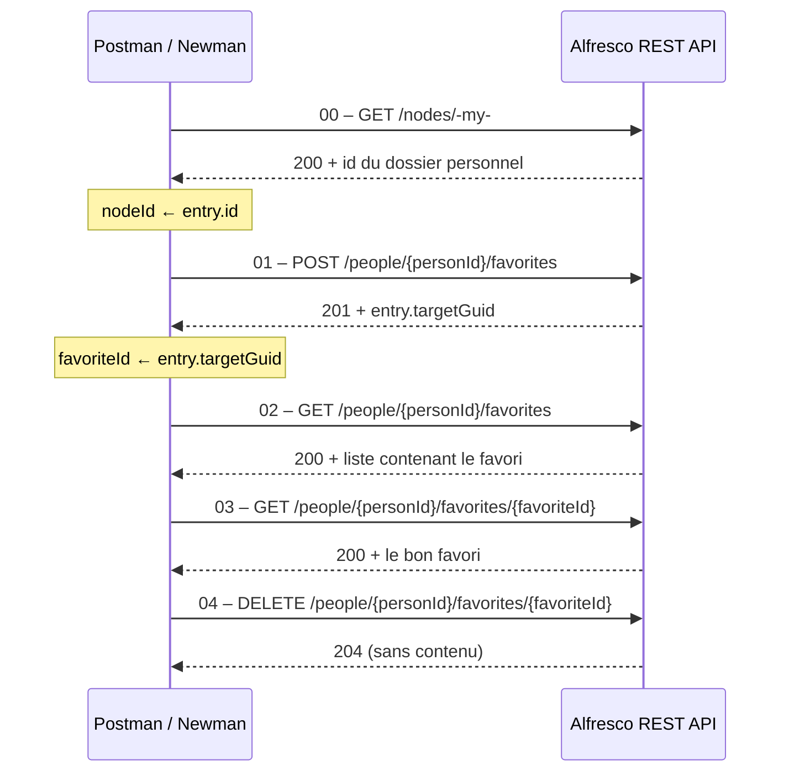

<div align="center">

# 🗂️ Alfresco – Tests d'API REST sur les favoris

**Validation automatisée, de bout en bout, du cycle de vie d'un favori via l'API REST Core v1 d'Alfresco.**


[Aperçu](#-aperçu) ·
[Démarrage rapide](#-démarrage-rapide) ·
[Scénario](#-scénario-de-test) ·
[Requêtes](#-détail-des-requêtes) ·
[Sécurité](#-sécurité) ·
[Roadmap](#-roadmap)

</div>

---

## 🎯 Aperçu

Cette collection **Postman** teste la gestion des **favoris** d'un utilisateur Alfresco : **création, liste, lecture et suppression**. Chaque requête embarque ses propres tests automatisés, et les requêtes s'enchaînent grâce à des variables alimentées dynamiquement.

| | |
|---|---|
| ✅ **Complet** | Cycle de vie entier d'un favori (CRUD sans mise à jour, qui n'existe pas pour les favoris) |
| 🔍 **Rigoureux** | Contrôle du code HTTP, de la structure JSON, du temps de réponse et de la cohérence des données |
| 🔁 **Rejouable** | La collection récupère elle-même le dossier à mettre en favori, puis nettoie après son passage |
| ⚙️ **Automatisable** | Exécution manuelle dans Postman ou en ligne de commande avec Newman (intégrable en CI) |

## 🧰 Stack

| Outil | Rôle |
|---|---|
| [Alfresco](https://www.alfresco.com/) | Instance cible des tests (locale ou distante) |
| [Postman](https://www.postman.com/downloads/) | Exécution interactive et scripts de test |
| [Newman](https://github.com/postmanlabs/newman) *(optionnel)* | Exécution en ligne de commande et CI |
| Authentification Basic | Compte Alfresco autorisé à utiliser l'API REST |

> L'URL par défaut suppose une instance locale sur `http://localhost:8080`. Adaptez `baseUrl` si votre serveur utilise un autre hôte ou port.

## 📁 Structure du dépôt

```text
Projet_Alfresco_Postman/
├── postman/
│   ├── ALFRESCO-Favorites.postman_collection.json   # Collection : 5 requêtes + tests
│   └── ALFRESCO-Local.postman_environment.json      # Environnement modèle (sans secret)
├── .gitattributes                                    # Fins de ligne normalisées (LF)
├── .gitignore                                        # Exclut secrets, rapports et fichiers locaux
├── LICENSE
└── README.md
```

## 🚀 Démarrage rapide

### 1. Cloner le dépôt

```bash
git clone https://github.com/<votre-utilisateur>/Projet_Alfresco_Postman.git
cd Projet_Alfresco_Postman
```

### 2. Importer dans Postman

Ouvrir Postman → **Import**, puis glisser les deux fichiers du dossier `postman/`.

### 3. Renseigner l'environnement

Sélectionner **ALFRESCO - Local** (menu en haut à droite) et compléter :

| Variable | À renseigner |
|---|---|
| `baseUrl` | `http://localhost:8080/alfresco/api/-default-/public/alfresco/versions/1` par défaut |
| `username` | Nom d'utilisateur Alfresco |
| `password` | Mot de passe (variable de type *secret*) |

`nodeId` et `favoriteId` restent **vides** : les scripts de test les remplissent automatiquement.

> ⚠️ Ne commitez jamais un environnement contenant vos identifiants. Utilisez la valeur *Current value* de Postman (non synchronisée) ou un fichier `*.local.json` ignoré par Git.

### 4. Lancer les tests

**Postman** : clic droit sur la collection → **Run collection** → vérifier l'ordre 00 → 04 → **Run**.

**Newman** :

```bash
npm install -g newman

newman run postman/ALFRESCO-Favorites.postman_collection.json \
  -e postman/ALFRESCO-Local.postman_environment.json \
  --env-var "username=<utilisateur>" \
  --env-var "password=<mot-de-passe>"
```

<details>
<summary>📊 Générer un rapport HTML</summary>

```bash
npm install -g newman-reporter-htmlextra

newman run postman/ALFRESCO-Favorites.postman_collection.json \
  -e postman/ALFRESCO-Local.postman_environment.json \
  --env-var "username=<utilisateur>" --env-var "password=<mot-de-passe>" \
  -r htmlextra --reporter-htmlextra-export newman/rapport.html
```

Le dossier `newman/` est ignoré par Git.

</details>

## 🔄 Scénario de test

Les requêtes dépendent les unes des autres : ne pas les réordonner ni les exécuter isolément (sauf la 00, point de départ).



## 🧪 Détail des requêtes

Toutes les URLs sont relatives à `{{baseUrl}}`. L'authentification **Basic** (`{{username}}` / `{{password}}`) est définie au niveau de la collection et héritée par chaque requête.

| # | Requête | Méthode | Tests automatisés | Variable écrite |
|---|---|:---:|---|---|
| 00 | **Setup : Get my home folder** `/nodes/-my-` | `GET` | Statut `200` · `entry.id` présent | `nodeId` |
| 01 | **Create a favorite** `/people/{{personId}}/favorites` | `POST` | Statut `201` · temps < 2000 ms · `entry`, `entry.targetGuid`, `entry.createdAt` présents · `targetGuid` = `nodeId` envoyé | `favoriteId` |
| 02 | **List favorites** `…/favorites?maxItems=100` | `GET` | Statut `200` · `list.entries` est un tableau · `list.pagination` présent · le favori créé figure dans la liste | — |
| 03 | **Get a favorite** `…/favorites/{{favoriteId}}` | `GET` | Statut `200` · `entry.targetGuid` = `favoriteId` | — |
| 04 | **Delete a favorite** `…/favorites/{{favoriteId}}` | `DELETE` | Statut `204` · corps vide | — |

**À noter** : la requête 01 possède une pré-requête qui interrompt l'exécution avec un message explicite si `nodeId` est vide, et la 04 remet l'instance dans son état initial pour que la collection reste rejouable.

## 🔧 Variables

| Variable | Portée | Valeur par défaut | Rôle |
|---|---|---|---|
| `baseUrl` | Collection + environnement | `http://localhost:8080/alfresco/api/-default-/public/alfresco/versions/1` | Racine de l'API Core v1 |
| `personId` | Collection | `-me-` | Alias désignant l'utilisateur authentifié |
| `username` | Environnement | *(vide)* | Compte Alfresco |
| `password` | Environnement (*secret*) | *(vide)* | Mot de passe du compte |
| `nodeId` | Environnement | *(rempli par la requête 00)* | Dossier mis en favori |
| `favoriteId` | Environnement | *(rempli par la requête 01)* | Favori créé |

Les valeurs de l'environnement priment sur celles de la collection.

## 🔐 Sécurité

Ce dépôt est préparé pour être public :

- **Aucun identifiant** dans la collection ni dans l'environnement : `username` et `password` sont vides.
- Mot de passe déclaré en variable de type **secret**.
- Identifiants de compte et de workspace Postman (`_exporter_id`, `_collection_link`) **retirés** de l'export.
- Aucun identifiant de nœud en dur : `nodeId` et `favoriteId` sont générés à l'exécution.
- `.gitignore` : exclut `*.local.json`, fichiers `.env`, rapports Newman et fichiers d'IDE.

**Bonnes pratiques**

- Utilisez un **compte de test dédié**, pas un compte administrateur.
- Ne ciblez **jamais la production** : ces tests créent et suppriment des données.
- Si un secret a été commité par erreur, **changez-le immédiatement** : l'effacer du dernier commit ne suffit pas, il reste dans l'historique Git.

## 🩺 Dépannage

| Symptôme | Cause probable | Solution |
|---|---|---|
| `nodeId est vide : exécutez d'abord 00 - Setup` | Requête 01 lancée seule | Exécuter la 00 d'abord, ou la collection complète |
| `401 Unauthorized` | `username` / `password` absents ou erronés | Vérifier l'environnement sélectionné |
| `Could not get any response` / `ECONNREFUSED` | Alfresco arrêté ou `baseUrl` incorrect | Vérifier hôte, port et chemin `/alfresco/api/-default-/public/alfresco/versions/1` |
| `{{baseUrl}}` littéral dans l'URL | Aucun environnement sélectionné | Choisir **ALFRESCO - Local** |
| Échec à l'étape 01 après une exécution interrompue | Le favori existe déjà (04 non exécutée) | Supprimer le favori manuellement ou relancer la 04 avec le bon `favoriteId` |

## 🗺️ Roadmap

- [ ] **Cas d'erreur** : `404` sur favori inexistant, `401` sans authentification, `400` sur corps invalide
- [ ] **Autres cibles** : favoris de type fichier et site, en plus du dossier
- [ ] **Pipeline CI** : Newman dans GitHub Actions, avec Alfresco lancé via Docker Compose
- [ ] **Tests pilotés par données** : fichier CSV/JSON pour plusieurs itérations

## 💡 Compétences démontrées

`Test d'API REST` · `Postman (scripts pre-request et tests)` · `Chaînage de requêtes et variables dynamiques` · `Newman / ligne de commande` · `Conception de tests rejouables` · `Gestion des secrets et sécurité d'un dépôt public` · `Documentation technique`

## 📄 Licence

Distribué sous licence **MIT**. Voir le fichier [LICENSE](LICENSE).

---

<div align="center">

**Auteur : [Votre Nom](https://github.com/<votre-utilisateur>)** · [LinkedIn](https://www.linkedin.com/in/<votre-profil>)

⭐ Si ce projet vous est utile, n'hésitez pas à lui laisser une étoile.

</div>
